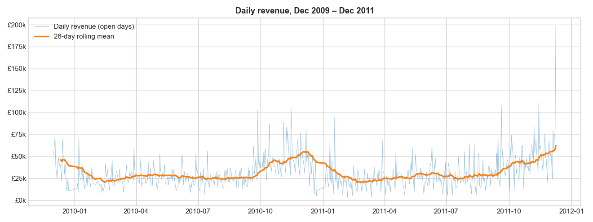
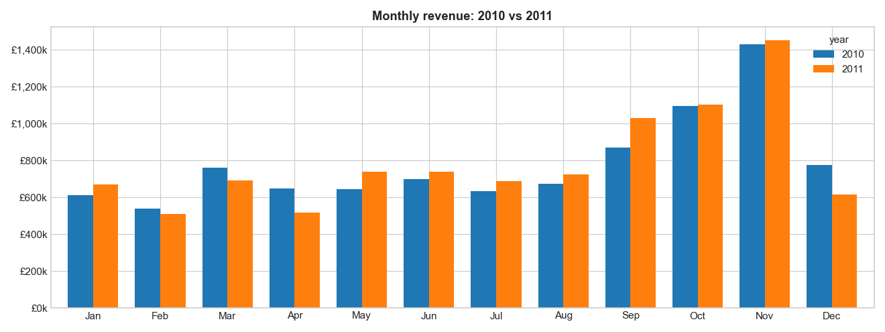
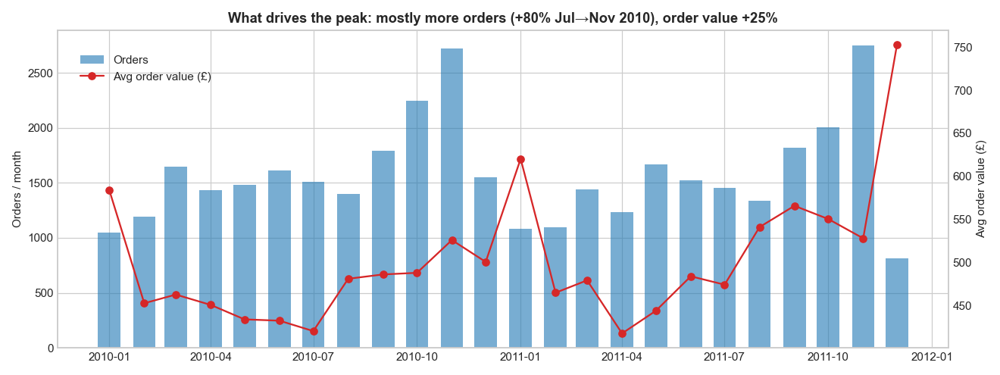
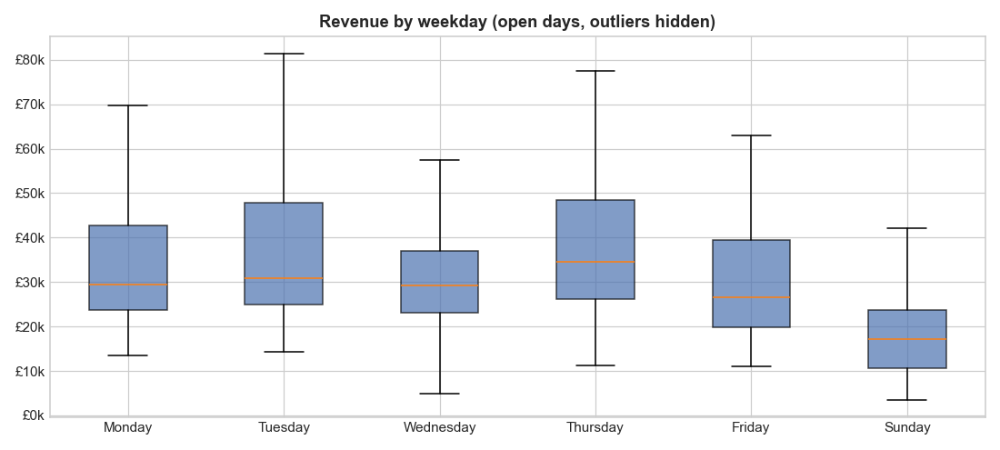

# Retail Sales Forecasting: Time Series Analysis & Machine Learning

Forecasting **daily revenue for a UK online retailer 13 weeks ahead**, covering the busy Sep–Dec peak season, so the business can plan stock, staffing and cash flow.



## Business problem

The retailer earns over a third of its annual revenue between September and November. Under-forecasting the peak means stock-outs and missed sales; over-forecasting ties up cash in unsold inventory. This project builds and compares forecasting models that predict daily revenue three months ahead, using only information that's known in advance.

## Dataset

[Online Retail II](https://archive.ics.uci.edu/dataset/502/online+retail+ii), UCI Machine Learning Repository (CC BY 4.0). It contains **1,044,848 real transactions** from a UK online gift retailer, Dec 2009 – Dec 2011.

**Cleaning:** removed cancelled invoices, returns, zero or negative prices, non-product codes (postage, fees, manual adjustments) and duplicate rows (4.0% of rows). The rest was aggregated to **739 days** (`daily_sales.csv`: revenue, orders, customers, units), **£19.6M total revenue**.

**Business calendar:** the shop takes no orders on Saturdays, UK bank holidays or 24 Dec – 3 Jan. A calendar rule explains every zero-sales day, so closed days are forecast as £0 and models are trained on the **603 open days**.

## Key insights from the analysis

| Insight | Evidence |
|---|---|
| **Strong yearly peak:** Sep–Nov = 36% of annual revenue | Nov 2010: £1.43M vs ~£0.65M in a typical month |
| **Steady growth:** Sep–Nov revenue +5.6% year on year | £3.39M (2010) → £3.58M (2011) |
| **The peak is driven mainly by order volume** | Jul → Nov 2010: orders +80%, avg order value +25% |
| **Stable weekly cycle:** Thursday is the best day, Sunday is about half a weekday | Median: Thu £34.5k, Sun £17.1k |

<p>


</p>



## Approach

1. **Train/test split by time:** the last 13 weeks (9 Sep – 9 Dec 2011, 79 open days) are held out, so the test covers the peak season. Training data covers one previous peak (2010).
2. **Leakage-free features** built only from the calendar: trend, weekday, month, week/day of year, days to Christmas and yearly Fourier terms. The whole 13-week forecast could be made on 8 September.
3. **Models compared:**
   | Model | Notes |
   |---|---|
   | Seasonal naive (baseline) | Same weekday 52 weeks ago × recent year-on-year growth, a spreadsheet-style rule |
   | Holt-Winters | Damped trend and weekly seasonality (statsmodels) |
   | Linear Regression | Log target (multiplicative weekday and seasonal effects) |
   | Random Forest | Tuned with `TimeSeriesSplit` cross-validation |
   | Gradient Boosting | `HistGradientBoostingRegressor`, tuned the same way |
   | Ensemble | Average of Linear Regression and Random Forest |
4. **Metrics:** MAE and RMSE (£/day), **WAPE** (Σ\|error\| / Σ actual, the standard retail metric) and **weekly WAPE**, since stock planning is done at weekly level.
5. **Final forecast:** the best model is retrained on all data to forecast 10–23 Dec 2011.

## Results

Baseline (seasonal naive) on the 13-week hold-out: **WAPE 32.9% daily, 19.3% weekly**, total bias +3.7%. This is the score every model has to beat.

Running the script prints the full comparison of all six models and saves it to `model_results.csv`. It also saves the forecast-vs-actual, weekly, residual and feature-importance charts to `images/`.

## How to run

```bash
pip install -r requirements.txt
python sales_forecasting.py
```

`daily_sales.csv` is included, so the script runs right away. To rebuild it from the raw data, download `online_retail_II.xlsx` from the UCI link above into this folder and delete `daily_sales.csv`; the script will rebuild it.

**Outputs:** charts in `images/`, `model_results.csv`, `forecast_next_2_weeks.csv`.

## Limitations & next steps

- Only two years of history, so there's just one previous peak to learn from
- One-off bulk wholesale orders cause unpredictable daily spikes
- No promotion, pricing or marketing data
- **Next:** prediction intervals for safety stock, category-level forecasts and a Power BI dashboard for the forecast

## Tech stack

Python · Pandas · NumPy · Matplotlib · Scikit-learn · Statsmodels

## Author

**Abhay Rawat**, MBA (AI & Data Science), Graphic Era (Deemed to be University) · [LinkedIn](https://www.linkedin.com/in/abhay-rawat-4a79b52b4/)
